### The postulates
**Postulate I:** The laws of physics are independent of the chosen inertial frame of reference.  
**Postulate II:** The speed of light in vacuum is the same in every direction and in every point of a given intertial frame of reference. It is identical for all inertial frames of reference.

### The spacetime interval
Let us consider an intertial frame $K$. At time $t_1$ we send a light pulse from $(x_1, y_1, z_1)$ to $(x_2, y_2, z_2)$, which arrives there at time $t_2$. If we denote the speed of light by $c$, we have
\$$ c(t_2-t_1)^2=(x_2-x_1)^2+(y_2-y_1)^2+(z_2-z_1)^2, \$$
or rearranging
\$$ s_{12}^2\equiv c(t_2-t_1)^2-l_{12}^2=0, \$$
where $l_{12}=(x_2-x_1)^2-(y_2-y_1)^2-(z_2-z_1)^2$ and we have defined the ***spacetime interval*** $s_{12}$ between two events. 

Because the above reasoning is frame-independent, we can state the same for an inertial frame $K^\prime$:
\$$ s_{12}^{\prime 2}=c(t_2^\prime-t_1^\prime)^2-l_{12}^{\prime 2} =0. \$$
We can thus see that if $s_{12}=0$, then $s_{12}^\prime =0$, too, so it is the same in all inertial reference frames.

>***Theorem.*** $s$ is the same in all inertial frames of reference.  
>***Proof:*** Consider when the time and space intervals are small, i.e. we have
>\$$ ds^2 = c^2 dt^2 - dl^2 \text{ and } ds^{\prime 2} = c^2 dt^{\prime 2} - dl^{\prime 2}. \$$
>Notice that 1) $ds=0 \iff ds^\prime=0$ and 2) $ds$ and $ds^\prime$ are of the same order $O(ds)=O(ds^\prime)$. These two facts allow us to conclude that $ds\propto ds^\prime$. 
>
>We now wish to determine the proportionality factor $a$. By virtue of the fact that space is uniform and isotropic (which is a result of the postulates), the factor can only depend on the value of $V$, where $V$ is the relative velocity between two intertial frames of reference. Consider the frames $K$, $K_1$ and $K_2$, with relative velocities between $K_1$ and $K$ being $V_1$, $K_2$ and $K$, $V_2$ and between $K_1$ and $K_2$, $V_{12}$. We must have
>\$$ ds = a(V_1) ds_1, \$$
>\$$ ds = a(V_2) ds_2, \$$
>\$$ ds_1 = a(V_{12}) ds_2. \$$
>What easily follows from the above is
>\$$ \frac{a(V_1)}{a(V_2)}=a(V_{12})^{-1}. \$$
>Because $V_{12}$ is a function of $V_1$, $V_2$ and the angle between $ \mathbf{V_1}$ and $ \mathbf{V_2}$, $a(V)=const.$ Otherwise we would be able to change the angle and thus the value of $a(V_{12})$ without changing the LHS. What trivially follows is that $a(V)=1$, so
>\$$ ds=ds^\prime \$$
>**always**. Because of the above and because $s=0$ means $s^\prime =0$, we must have
>\$$ \boxed{ s=s^\prime,} \$$
>i.e. the spacetime is invariant between all inertial frames of reference. $\blacksquare$

### Deriving the Lorentz transformation: method 1
Without loss of generality we will assume that $x_1=y_1=z_1=0$ and $t_1=0$ (it can be achieved by the right choice of a reference frame and an initial moment) and that $K$ and $K^\prime$ are in the same point in space at $t=t^\prime=0$. We also assume that their $x$ and $x^\prime$ axes are aligned and $K^\prime$ is moving along the positive $x,x^\prime$ axis. We will denote $ct$ as $\tau$.

First we will prove that the coordinates in the plane perpendicular to the relative velocity (here $yz$) are invariant. Consider a rod $AB$ which moves with $K$ and lies on the y axis. Consider an identical rod $A^\prime B^\prime$ lying on the $y^\prime$ axis. The centres of the rods, $C$ and $C^\prime$, are in the same point at $t=t^\prime=0$. We now measure the length of $AB$ from $K^\prime$ and the length of $A^\prime B^\prime$ from $K$. If $AB>A^\prime B^\prime$ or the other way around, we can tell a difference between the two frames of reference, which violates the first postulate.

Because $y=y^\prime$ and $z=z^\prime$, we have
\$$ \tau^2 - x^2 = \tau ^{\prime 2} -  x^{\prime 2}, \tag{1} \$$
where $\tau = ct$. The transformation should be independent of the choice of $x=0$, so it must be linear. Otherwise an additional term dependent on both $x_0$ and $x$ would be introduced, changing the form of the transformation, which, by virtue of the first postulate, should be invariant. We must have:
\$$\begin{cases} x ^\prime= a_1 x + b_1 \tau \\\\ \tau  ^\prime = a_2 x + b_2 \tau. \end{cases} \$$
We plug this into (1):
\$$ \tau^2 - x^2 = (a_2^2 - a_1^2) x^2 + (b_2^2 - b_1^2) \tau^2 + 2(a_2b_2 - a_1b_1)x\tau. \$$
Comparing both sides, we arrive at
\$$ \begin{cases} a_1^2 - a_2^2 = 1\\\\ b_2^2 - b_1^2 = 1 \\\\ a_2b_2=a_1b_1, \end{cases} \$$
which can be checked to be satisfied by
\$$ \begin{cases} a_1=b_2=\cosh\theta \\\\ a_2=b_1=\sinh\theta. \end{cases} \$$
We thus have
\$$\begin{cases} x ^\prime= x\cosh\theta +\tau\sinh\theta \\\\ \tau  ^\prime = x\sinh\theta + \tau\cosh\theta. \end{cases} \$$
Let $x ^\prime=0$. We then have
\$$ \tanh\theta = - \frac{x}{\tau} = - \frac{x}{ct}, \$$
which is none other than the velocity of the origin of $K ^\prime$ w.r.t. $K$, denoted by $V$. If we denote $V/c$ by $B$,
\$$ \tanh\theta = -B. \$$
We can make use of the identity
\$$ \cosh\theta = \frac{1}{\sqrt{1-\tanh^2\theta}} \$$
to get
\$$ \cosh\theta = \frac{1}{\sqrt{1-B^2}} \equiv \Gamma. \$$
We also have
\$$ \sinh\theta = \cosh\theta\tanh\theta = -\Gamma B. \$$
We thus arrive at
\$$\boxed{\begin{cases} x ^\prime= \Gamma\left(x-Vt\right) \\\\ t ^\prime=\Gamma\left(t - \frac{V}{c^2}x\right). \end{cases}} \$$

### Deriving the Lorentz transformation: method 2
We can see a simmilarity between $s^2=\tau^2 - x^2$ and length in eucledian 2D space. Notice, that if we introduce complex time, $\tilde{\tau} \equiv i\tau$, the interval becomes $s^2 = - \left( \tilde{\tau}^2 + x^2\right)$. This the negative distance between two points in the $x\tilde{\tau}$ plane, which is obviously conserved when rotating the axes. 

Recalling the standard formulae for rotating orthogonal systems of coordinates:
\$$ \begin{cases} x ^\prime=x\cos\phi + \tilde{\tau} \sin\phi \\\\ \tilde{\tau} ^\prime=  - x\sin\phi + \tilde{\tau}\cos\phi. \end{cases} \tag{2} \$$
(The axes are rotated counter-clockwise, so all vectors are rotated clockwise in the new coordinate system; this is different from the standard rotation matrix, because it's *the axes* that are rotated).

We now seek $\phi$. It can only depend on $V$, because this is the only difference between reference frames. Consider a point rigidly bound to $K ^\prime$. In $K$ we then have:
\$$ V = \frac{dx}{dt}. \$$
If we take the differential of the first equation from (2) and acknowledge that for the point in consideration $dx ^\prime=0$, we get
\$$ 0 = dx \cos\phi + d\tilde{\tau} \sin\phi. \$$
Remembering that $\tilde{\tau} = ict$, we now have an easy way to acquire $\phi$:
\$$ \tan\phi = - \frac{dx}{d\tilde{\tau}}= - \frac{dx}{ic\,dt} = \frac{i}{c} \frac{dx}{dt} = \frac{iV}{c} = iB. \$$
We also calculate $\cos\phi$:
\$$ \cos\phi = \frac{1}{\sqrt{1+\tan^2\phi}} = \frac{1}{\sqrt{1-B^2}}=\Gamma \$$
and $\sin\phi$:
\$$ \sin\phi = \cos\phi\tan\phi = i\Gamma B. \$$

Plugging all of this into (2), we arrive at
\$$ \begin{cases} x^\prime = \Gamma \left(x + iB \tilde{\tau}\right) \\\\ \tilde{\tau} ^\prime=\Gamma \left(\tilde{\tau} - iBx\right). \end{cases} \$$
If we remember that $\tilde{\tau} = ict$, we recover the original Lorentz transformation.

### The geometrical interperation
Because the $y$ and $z$ coordinates are invariant under the transformation in our configuration, we will only consider the $x\tau$ plane. Let's see how the Lorentz transformation changes the axes. 

First consider the $\tau ^\prime$ axis, so $x ^\prime = 0$. We must have
\$$ \Gamma\left(x - B\tau\right) = 0, \$$
so for that axis we have $x = B\tau$, which means that it's tilted by an angle $\arctan B$ to the $\tau$ axis. This situation is shown in figure 1. We can clearly see that even if $\tau ^\prime=0$, it does not necessarily mean that $\tau=0$. This is a consequence of the fact that clocks synchronised in $K$ are not synchronised in $K ^\prime$.

By repeating the same steps for the $x ^\prime$ axis, we find that its tilted by the same angle $\arctan B$ to the $x$ axis. We also see that for $x ^\prime=0$, we need not have $x=0$, which follows from the relative movement of both reference frames. This phenomenon also occurs in classical mechanics.

 
<em>Fig. 1</em>

Consider the point $(1, 0)$ in $K ^\prime$. Its coordinates can be easily calculated to be $(\Gamma, \Gamma B)$ in $K$. We can thus see that the unit length on the $x ^\prime$ axis is $\sqrt{\Gamma^2+\Gamma^2 B^2} = \sqrt{ \frac{1+B^2}{1-B^2}}$ times longer than the one on the $x$ axis. The same follows for $\tau ^\prime$ - the primed axes get stretched.

To illustrate this, consider a rod stationary in $K$, having its ends at $x_0=0$ and $x_1$. According to the Lorentz transformation, $l=x_1-x_0=\Gamma\left(l ^\prime + V(t_2 ^\prime-t_1 ^\prime)\right)$. For the measurement in $K ^\prime$ to make sense, the ends have to measured at the same time, so $t_1 ^\prime = t_2 ^\prime$ and we have $l ^\prime = l / \Gamma$, so the rod gets shorter.

Now we use the geometrical method, shown in figure 2. Because $t_1 ^\prime = t_2 ^\prime$, we tilt the rod in the $K$ frame so that is parallel to $x ^\prime$, but still has length $l$ when projected onto $x$. The length of the rod along the $x ^\prime$ axis is now $l\sqrt{1+B^2}$, but because $x ^\prime$ has a different unit length, we have $l ^\prime = l \sqrt{1+B^2} \sqrt{ \frac{1-B^2}{1+B^2}} = l/\Gamma$, as expected.

 
<em>Fig. 2</em>

All of the above has been discussed from the point of view of $K$. However, an observer in $ K ^\prime$ looking at $K$ will, by virtue of the first postulate, observe the same effects occur in $K$. We can also see this from the inverse Lorentz transformation, which we get by either solving for $x ^\prime$ and $\tau ^\prime$, or changing the primes and replacing $V$ with $-V$:
\$$ \begin{cases} x= \Gamma\left(x ^\prime+Vt ^\prime\right) \\\\ t=\Gamma\left(t ^\prime + \frac{V}{c^2}x ^\prime\right). \end{cases} \$$
This time, however, due to the sign next to $V$, the axes are tilted in the opposite direction, as shown in figure 3.

 
<em>Fig. 3</em>

